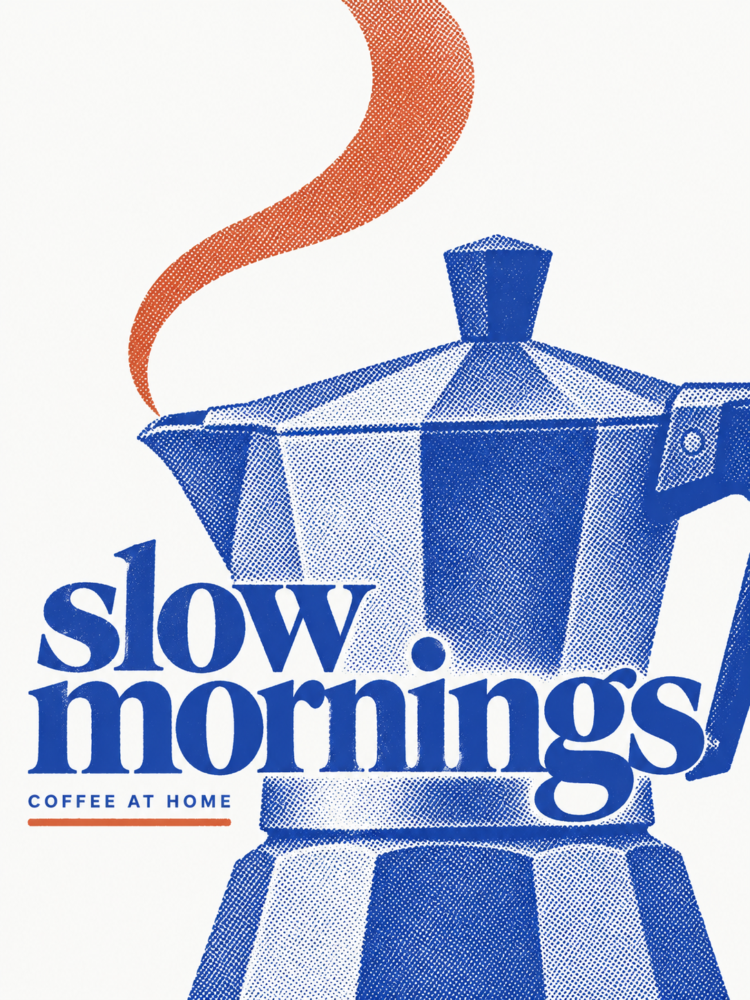
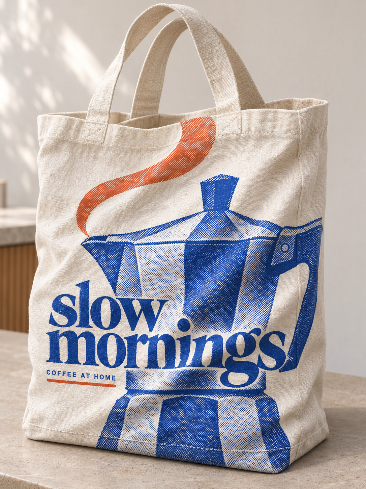

# 同一作品与帆布袋应用

本轮演示生成，母图与帆布袋场景均为练习案例。

## A：原创母图

母图复用本轮“双色咖啡海报”案例的原创输出，不取用第三方受限 examples。

## B：应用到织物

将 A 作为 image_gen 的实际图像参考，锁定摩卡壶、蒸汽、文字与蓝橙油墨角色，再要求印花服从布面褶皱、侧褶、缝线及织纹。该图是生成的应用演示，不是实物生产记录。

已逐图查看：两句文字拼写保持，母图的主体与主次颜色可识别；纹理和图形随袋体弯折，袋口、提手、侧面和底部接触关系可见。

方法来源：[mono-color-showcase-pairs](https://github.com/xupengli406-del/claude-skills/tree/dade8c1ec9615bc52cd142890d99a8b6e55194bd/mono-color-showcase-pairs)。

配套输入、完整提示词和方法来源见本目录的 `输入与配方.json`、`提示词.json`、`来源与方法.json`。
