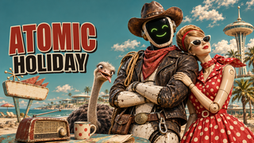

# Atomic Holiday：原子时代复古未来封面练习

本轮演示生成的练习案例，不是参考作者原有作品。主题为“原子假日”，采用 standing-poster：先制作无字底图，再按 compose_cover.py 叠加 ATOMIC / HOLIDAY 双层标题。

左侧标题区、右侧紧密群像、机器人/成年复古人偶/鸵鸟的高低关系、海滨 Googie 建筑与局部旧化按原方法组织。上行 Impact、下行 Anton；砖红、暖炭黑、奶油描边和硬阴影由脚本确定性合成。字体不随本例另行分发，Anton 及其许可沿用 Skill 已有素材。

底图见 [plate.png](plate.png)，布局见 [layout.json](layout.json)。已实际查看完整封面和 320px 缩图；属于案例视觉检查，不代表平台点击效果或用户已选定。原风格参考截图仍按原 Skill 的来源与分片说明管理，不随本例另发。
